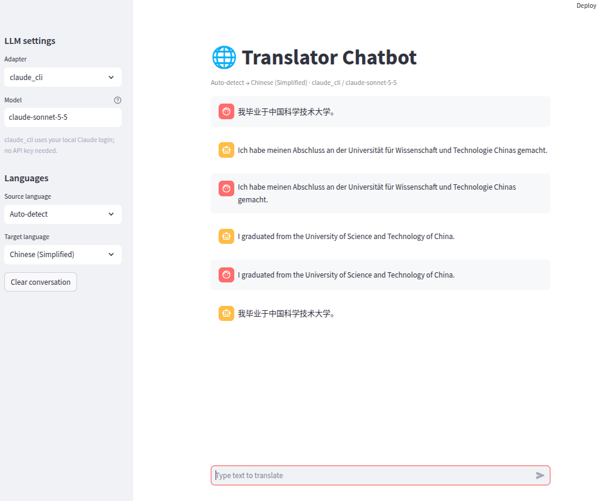

# code_parts

`code_pipeline` without SPL: check the spec, write the code, review it, then improve it and **run it** until it passes (a verification loop) with **no `.spl` files and no SPL.py**. Where `code_pipeline` runs each step as an SPL sub-workflow (`procedure_ref`), here each step is a *part*: a named subgraph, a small workflow file used as one node and expanded in place when the graph loads.

```
analyze -> gate --[READY]--> write -> review -> repair loop -> done
              \--(not ready)--> abort (run stops)

repair loop (at most max_cycles rounds, stops when a round passes):
    improve -> collect (split into files) -> verify (run them) --[passed]--> exit
                  ^                                  |
                  +------ the report, as the test result of the next improve
```

| | |
|---|---|
| Inputs | `spec` (TEXT, required), `lang` (TEXT, default `python`), `reference` (TEXT, optional: API facts the model cannot know), `smoke` (TEXT, optional: Python run against the real dependencies), `max_cycles` (INTEGER, default 2) |
| Outputs | `code` (FILES, a project folder: `<run folder>/code/`), `review` (TEXT, `review.md`), `report` (TEXT, `report.md`: what the last verification found) |
| LLM calls | 3 + one per repair round (at most 3 + `max_cycles`); 1 if the spec is rejected |
| Files | `code_parts.graph.yaml` (compact form), `sub_graph/*.graph.yaml` (one part per step), `sub_graph/prompts/*.md` |

## SPL sub-workflow or part

| In `code_pipeline` | Here |
|---|---|
| `01_generate_code.spl`: a `CREATE FUNCTION` with the prompt, a `WORKFLOW` that calls it and writes a file | `sub_graph/write_code.graph.yaml` + `sub_graph/prompts/write_code.md` |
| `procedure_ref: procedures.review_code`, run by SPL.py's executor | `use: parts.review_code`, expanded to ordinary nodes (`review__gen`) |
| `{spec}` placeholders | `{{in_spec}}` ports |
| `EVALUATE ... WHEN contains('[READY]')` | an `evaluate` step, with a `RECOVER` halt on the other branch |

The prompt text is the `.spl` files' (`tests/test_code_parts.py` checks it); `write_code` and `improve_code` add one paragraph asking for the code as project files. Left out on purpose: the artifact files the procedures write, the per-step `WITH OUTPUT BUDGET` and the exception handlers, none of which the graph needs; the graph's workflow outputs and the run folder's `nodes/` hold the results.

## The generated code is a project folder

The model does not return one block of code. `write_code` and `improve_code` ask for files, each introduced by a line `=== FILE: path/to/file ===`: a `README.md` first, then the sources, split into modules that import each other when the spec has more than one concern. The `collect` step (`tools/collect_files.py`, a `SOLVE` with `backend: subprocess`) splits the reply, strips code fences, refuses paths that leave the folder, adds an `__init__.py` to every Python package folder so the imports work, and adds a `README.md` from the spec if the model wrote none. A reply with no markers becomes one file, `main.<ext>`.

The workflow output `code` is declared `type: FILES` (a mapping of relative path to text), so `graf run` writes it as a real folder instead of `code.md`:

```
output/code_parts-<adapter>-<model>-<time>/
  code/                  <- the generated project
    README.md
    slugger/__init__.py  slugger/core.py  slugger/cli.py
    tests/test_slugger.py
  review.md              <- the review feedback
  result.json  run.json  summary.json  nodes/
```

Run its tests from the project folder: `cd output/<run>/code && python -m unittest discover -s . -p "test_*.py"`.

## Run

```bash
graf run cookbook/code_parts/code_parts.graph.yaml --llm claude_cli:claude-haiku-5-5 \
    --param spec="a function is_palindrome(s) that ignores case and punctuation"


graf run cookbook/code_parts/code_parts.graph.yaml --llm claude_cli:claude-sonnet-5-5 \
    --param spec="write a chatbot using streamlit web framework which will translate text from source lang to target lang, using LLM adapter=claude_cli, model=claude-sonnet-5-5 as default, but user can configure with other adapter/model options including API_KEY setting"


graf run cookbook/code_parts/code_parts.graph.yaml --llm claude_cli:claude-haiku-5-5 --param spec="make something useful"   # stops after 1 call

graf vis cookbook/code_parts/code_parts.graph.yaml      # each part use drawn as a box; no mermaid needed
graf expand cookbook/code_parts/code_parts.graph.yaml   # the flat graph: analyze__gen, write__gen, ...
```

Each step may name its own LLM: add `llm: "ollama:gemma3"` to a `use` step (`- review: {use: parts.review_code, llm: "ollama:gemma3", ...}`) and the part's `GENERATE` node uses it, unless the part file's node names its own.

## Verification: the code is run, not just reviewed

After each `improve`, the `verify` step (`tools/verify_project.py`, a `SOLVE` with `backend: subprocess`) writes the project to a temporary folder and checks it, in order: **syntax** (every `.py` compiles), **imports** (every module imports; a third-party package not installed here is skipped, not failed), **tests** (the project's own, with pytest or unittest) and **smoke** (your optional `smoke` code, run with the project importable). A failure goes back into the next `improve` as the test result, and the loop stops when a round passes or after `max_cycles`. Only Python projects are checked; other languages pass with a note.

Why `smoke` and `reference` exist: the model writes the tests too, and it fakes any library it calls, so a wrong call passes its own tests. In a real run (a translator package calling `dd_llm`) the model guessed `generate()`, then `complete()`, neither of which exists. All 27-32 of its tests passed, and only the smoke code, which called the real library, failed. The loop caught it every round, but the model could not repair what it could not know: it kept its guess for 3 rounds and finished `[FAILED]`. The fix is to tell it. Give the real call in `reference`, and the same run passed in one round (29 tests and a real smoke call):

```bash
graf run cookbook/code_parts/code_parts.graph.yaml --llm claude_cli:claude-haiku-5-5 \
    --param spec="a Python package translator_bot whose module core.py exposes translate(text: str, target_lang: str) -> str ..." \
    --param reference='dd_llm: adapter = get_adapter("claude_cli"); result = adapter.call(prompt, model="..."); result.success, result.content' \
    --param smoke='from translator_bot.core import translate
out = translate("Good morning", "French"); assert out.strip() and "morning" not in out.lower(), out'
```

The `smoke` code may make real calls (the example calls the model once per round), so it can spend. Name the modules and functions the smoke code uses in the spec, since the layout is the model's choice.

**This runs the generated code on your machine**: with a timeout and a temporary folder, but no sandbox. A `SOLVE` with `backend: subprocess` accepts `container: {image, ...}` to run it in Docker (no network, read-only), if the image has the packages the project needs.

## Milestone: a working app from one prompt (2026-10-31)

The first end-to-end use of this recipe on a real application: a Streamlit translation chatbot, written from this single spec and run on `claude_cli` with `claude-sonnet-5-5`.

> write a chatbot using streamlit web framework which will translate text from source lang to target lang, using LLM adapter=claude_cli, model=claude-sonnet-5-5 as default, but user can configure with other adapter/model options including API_KEY setting



*The app the recipe generated, translating a Chinese sentence to German, that German back to English, and that English to Chinese. The adapter and model are the sidebar's defaults; both can be changed there, and the sidebar says that `claude_cli` needs no API key.*

What the run produced: a package folder (`code/`) with a README, modules that import each other, tests and a `pyproject.toml`, plus `review.md` and `report.md`, with no `.spl` file or SPL.py involved.

How it got there, in order:

1. **First run:** the app started, but a translation failed with `The LLM adapter has no 'generate' method`. The model had guessed the adapter's API. Its own tests passed, because it also wrote the fake the tests used.
2. **Fix in the recipe, not by hand:** the repair loop now runs the generated code (syntax, imports, tests, optional `smoke` code against the real library) and feeds the failures into the next `improve`. A `reference` input carries facts the model cannot know, such as the real `dd_llm` call. In a controlled rerun (a translator package, haiku), the loop failed all 3 rounds without `reference`, and passed in one round with it. See "Verification" above.
3. **Result:** the app in the screenshot, which translates in every direction tried.

What this shows, and what it does not:

- It shows that a graph can wrap a model's code writing with a spec gate, an independent review, a real project layout and a loop that executes the result. The model writes the code; the graph decides what happens to it and what counts as done.
- It does not show that one prompt is always enough. The model could not know dd-llm's API; someone had to supply it (`reference`) and someone had to write the check that proves it (`smoke`).
- The screenshot is the happy path. Error handling (a bad key, an empty input, a timeout) was not exercised by hand.
- One run is an anecdote, not a measurement. Nothing here compares this against writing the app by hand or against a plain one-shot prompt.

Two comments on where this sits:

1. **This recipe showcases vibe-coding.** A natural-language spec goes in and an application comes out, with the structure of the code left to the model. The graph does not make that approach more disciplined; it makes it safer to use, by adding a gate, a review and a loop that runs the result. What the model builds is still its own design.
2. **Planned, not built: a more disciplined route.** Later we intend to refactor this graph-code with GraphLang itself, so that an application is generated from a blueprint `graph.yaml` (the application's own structure written as a graph, which the model then fills in), instead of from a free-text spec. The aim is to build an AI application by design, with the graph as the source of truth, rather than by vibe-coding. Nothing of this exists yet; the blueprint format and how it would be checked are open.

## What is not here

The Cedar-guarded retry, the documentation step and the closure judge stay in `code_pipeline`. That recipe keeps its `.spl` procedures because the `code_pipeline` experiment runs the same procedures in all its arms.
