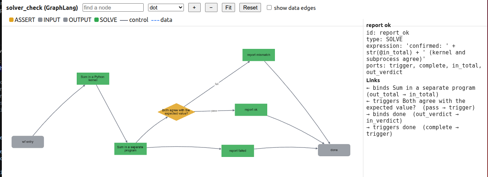

# solver_check: SOLVE with a kernel and with a subprocess

Two deterministic solvers compute the same sum, and an `ASSERT` checks that they agree with each other and with the expected value. There is no LLM, so it runs offline and always gives the same answer.

```
wf_entry -> sum_kernel (Python kernel) -> sum_script (subprocess) -> agree (ASSERT) -- pass --> report_ok ----------\
                                              |                          \-- fail --> report_mismatch ----------> done
                                              \-- error (solver failed) -------------> report_failed -----------/
```

## Run

### Visualize graph.yaml
```bash
graf vis cookbook/solver_check/solver_check.graph.yaml
```



### Test

```bash
pip install -e ".[kernel]"          # jupyter_client and ipykernel, for the kernel node
graf run cookbook/solver_check/solver_check.graph.yaml --param numbers=1,2,3 --param expected=6
# confirmed: 6 (kernel and subprocess agree)
graf run cookbook/solver_check/solver_check.graph.yaml --param numbers=1,2,3 --param expected=7
# MISMATCH: kernel 6, subprocess 6, expected 7
```

## What it shows

- **`sum_kernel`** (`backend: kernel`): the input `numbers` arrives as a Python variable, the `code` computes `total`, and the `result` expression is the node's output, checked against `out_type: INTEGER`. The values are passed as data, so they can never change the code.
- **`sum_script`** (`backend: subprocess`): `solvers/sum_numbers.py` is a black box. It reads the inputs as JSON on stdin and prints text; `solvers/parsers.py:total` is a custom parser that turns that text into an integer. If the script exits non-zero, times out, or prints something the parser cannot read, `on_error: route` sends the run to `report_failed` instead of ending it.
- **`agree`** is an `ASSERT`, which reads the two results and decides which report runs. Exactly one report runs, so only one writes the verdict.

## Your own solver

Replace `solvers/sum_numbers.py` with anything that reads JSON on stdin (a Z3 script, a Lean call, a Rust binary) and write a parser for its output, or use a built-in one: `last_json` if it prints JSON, `first_line` for `sat`/`unsat`, `regex` for text. The node does not change, only `command` and `parse`. `tests/test_solver_check_example.py` covers the three outcomes.

## Where things are

| File | Role |
|---|---|
| `solver_check.graph.yaml` | the workflow |
| `solvers/sum_numbers.py` | the black-box solver |
| `solvers/parsers.py` | the custom parser, `total(stdout) -> int` |

Code runs with your privileges and comes only from this graph's folder; a MUTATE node may not add or change any of it.
